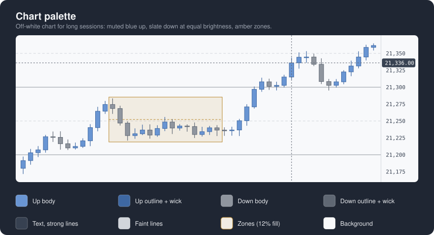

# Trading Indicators

Personal collection of trading indicators and chart tools for three platforms:

| Folder | Platform | Language |
|--------|----------|----------|
| [`ninja-trader/`](ninja-trader/) | NinjaTrader 8 | C# (NinjaScript) |
| [`profit-chart/`](profit-chart/) | Profit Chart (Nelogica) | NTSL |
| [`tradingview/`](tradingview/) | TradingView | Pine Script |

> Shared as-is, with no guarantees, and built mostly with AI assistance —
> read the [Disclaimer](#disclaimer) before using anything here.

Default colors for light charts follow one [chart palette](#chart-palette).

## NinjaTrader 8 (`ninja-trader/`)

Install steps and platform quirks: [`ninja-trader/README.md`](ninja-trader/README.md).

### RenkoWicks — Renko bars type + chart style

- Keeps the counter-trend price movement inside each brick as a wick, instead
  of discarding it like standard Renko.
- Up bricks: pull-back low becomes the lower wick. Down bricks: rally high
  becomes the upper wick. Trend side stays pinned to the brick boundary.
- Gap-filler synthetic bricks render faded ("Gap brick opacity") with zero
  volume. This includes session boundaries: with Break at EOD on, the
  overnight move is walked with faded bricks to the session open instead of
  leaving an unspanned jump — the chain never shows a void.
- Separate outline and wick colors for up and down bricks ("Candle outline
  (up)", "Candle wick (down)", ...); bar-width changes apply immediately.
- Defaults: 50-tick bricks, 15 days of data.
- Tick Replay not supported for this bars type.
- Use: compile both files, restart NinjaTrader, select "Renko with Wicks" as
  the chart's bar type in Data Series ("Brick Size" = ticks), F5 to rebuild
  after changing the size.

### ErgonomicCharts — native-feeling zoom and pan

- Scroll-wheel zoom without holding Ctrl, using the platform's own
  bar-spacing hotkeys (no drift).
- Drag-to-pan ("Enable drag-to-pan", on by default) via simulated
  Ctrl-drag.
- Gestures stop at the panel edges, skip the price/time axis, and scope to
  the hosting panel on multi-panel charts.
- The simulated Ctrl press is session-wide; if NinjaTrader crashes mid-drag,
  tap the physical Ctrl key to clear the stuck state.
- Use: add to any chart, scroll to zoom, drag to pan.

### ChartTrading — click-to-trade with an exact bracket preview

- Hold a modifier key over the chart to preview a bracket at the mouse;
  click to submit it.
- Shift = buy preview, Alt = sell preview (both keys configurable). Preview
  tracks the pointer and labels the exact order type a click would submit
  (`LMT`, `MIT`, `STP`, `STP LMT`, `MKT`).
- Click submits the entry to the ChartTrader account. Stop/target orders go
  live against filled quantity, grow with partial fills, and are OCO-linked
  per pair. They sit their configured distance from where the entry actually
  fills, so a limit moved after placement (dragged, or attached to a moving
  average) still gets its stop and targets at the right distance.
- Preview is exact — comes from the indicator's own settings, so it matches
  what gets submitted to the tick.
- Up to three stop/target pairs, each with its own checkbox, tick distances,
  and percentage share.
- Optional ATR distances: every stop sits "Stop size (x ATR)" away and each
  target that many R (stop distance times the pair's R; defaults 1R, 2R,
  3R). The ATR settings default to the Candle Countdown & Position Sizer's
  (1.5 x ATR, length 5, exponential), so the bracket uses the stop the
  sizer sized the lot for — keep both indicators' ATR settings equal if
  you change them. Distances are taken at click time. Auto breakeven then
  triggers in R too ("Auto breakeven trigger (R)", default 1R: once price
  has run one stop distance in your favor), measured against the latest
  click's ATR stop. The settings dialog shows only the selected mode's
  fields; reopen it after switching "Distances" if they don't refresh.
- Entry always trades the ChartTrader quantity outright (never multiplied by
  pair count); each enabled pair gets its percentage share of that quantity,
  split into whole lots as evenly as the math allows (e.g. 4 lots at
  25/25/50% → 1/1/2).
- Percentages are meant to total 100 but are renormalized across whichever
  pairs are enabled, so a disabled pair's share always lands on the others. A
  pair whose share rounds down to zero lots is skipped for that order.
- Entry type: Limit or MIT on the favorable side of the market, Stop-Market
  or Stop-Limit (with a tick offset) beyond it.
- "Entry price: Market" turns every click into a market order instead: the
  modifier key picks buy or sell, the pointer position doesn't matter, and
  the preview sits at the ask (buy) or bid (sell). Stops and targets are
  placed from the actual fill price, so slippage doesn't shift the bracket.
- Time in force: Day (default) or GTC, applied to the entry and every
  stop/target.
- "Separate stacked stops": nudges colliding stop prices one tick apart so
  each stays individually draggable.
- Tag position (left/center/right + margin). Stop and target tags show any
  mix of price, ticks, points and money for the level's quantity (default:
  price, ticks, money).
- "ChartTrading ON/OFF" button in the ChartTrader panel (shown only when
  ChartTrader is visible as the indicator loads): green = clicks place orders, gray = disabled.
  The state is kept across reloads and saved with the workspace; "Enabled"
  in the settings sets it too.
- Auto breakeven (off by default): moves stops to breakeven once price runs
  a configured tick trigger in the position's favor, once per position,
  re-arms on close/flip. Several fills average between ticks; breakeven
  rounds toward profit. For the manual move, add Better Trading Panel.
- No live-account gate — whichever account is selected in ChartTrader is
  what a click trades; the ON/OFF button (or the "Enabled" setting) is the
  only switch.
- Auto-breakeven only runs while the chart is open (local automation, not
  server-side).
- Removing or reloading the indicator leaves stops and targets working,
  but cancels entries that have not filled yet: once it stops listening
  they would fill with no bracket.
- Don't enter the same instrument through another automated bracket/order-
  management feature at the same time — two systems will fight over the
  same position's exits.
- Use: add to a chart with ChartTrader visible, set your bracket pairs, turn
  ChartTrading ON, hold Shift/Alt to preview, click to trade.

### ATRRenkoSizeCalculator — ATR sized for Renko bricks

- ATR smoothed with an EMA (not Wilder's average), plotted with its half
  value.
- On-chart table: ATR, half ATR, half ATR in ticks.
- "Ignore gaps" (default on) excludes the session-open gap from the true
  range.
- Settings: ATR length, decimal places, table and half-ATR toggles.
- Use: add to the instrument you trade, read "Half ATR (Ticks)" as the
  brick size.

### MACDHistogram — momentum-colored MACD histogram

- Strong shade when momentum grows (rising above zero, falling below),
  light shade when it fades back toward zero, neutral color at exactly
  zero. Defaults follow the chart palette: blue above zero, slate below.
- All five colors configurable, persist across workspace reloads.
- Histogram bar width matches the chart's bar width.
- Settings: fast/slow/smooth periods (12/26/9 defaults) plus the colors.
- Use: add to a chart; defaults give the standard 12/26/9 histogram in its
  own panel.

### VolumeWithEMA — volume vs its average

- Volume histogram with an EMA of volume plotted over it.
- Bars colored by relation to the EMA (above/below colors configurable,
  persist across reloads).
- EMA period configurable (14 default).
- Updates tick by tick.
- Use: add to a chart, watch for above-average bars to confirm moves.

### MultiSeriesEMA — an EMA from a different bar series

- Overlays an EMA computed on a bar series independent of the chart it's
  on (different Renko brick size, higher timeframe, tick/range bars), never
  drawing that series.
- "Source Type": Minute, Renko, Tick, Range, or Day. Renko swaps in a
  brick-size-in-ticks field; every other type shows a period field.
- Source series is data-only: no second panel, no extra candles/bricks.
- EMA period and line color configurable.
- Use: add to any chart, pick a source type/size different from the chart's
  own, set the EMA period.

### OrderDecorator — distances on your working orders

- Labels every working order on the chart's instrument (any tool's orders,
  not just this repo's) with its distance from the position's average
  price: ticks, optional points, and money value for the order's
  remaining quantity.
- Profit-side orders also show their R multiple against the nearest
  working stop.
- The execution (average price) line gets its own label: position side,
  quantity, and live unrealized P&L in ticks and money.
- Colors by side: profit green, loss red; flat = neutral gray with
  distance from the last price instead.
- Orders at the same price merge into one label with the summed quantity,
  matching how the platform stacks their markers. Orders a few ticks apart
  get their labels stacked so they never overlap.
- Each value (ticks, points, money, R) has its own on/off setting.
- "Right margin" setting (default 50 px) keeps the labels clear of the
  platform's own order markers.
- Reads the ChartTrader-selected account; labels update tick by tick.
- Use: add to a chart with ChartTrader visible; working orders get their
  numbers automatically.

### RiskRewardTargets — risk/reward drawing tool with three targets

- Drawing tool (chart's Draw menu), not an indicator: two clicks place entry
  and stop, targets appear at 1R/2R/3R.
- Every anchor — entry, stop, and each target — drags independently; each
  target's label shows its price, distance in ticks, and its R multiple,
  recomputed live from the current entry/stop distance. The built-in
  RiskReward tool instead locks target and stop to a fixed ratio.
- 1 to 3 targets ("Targets" setting); works for long and short (stop side
  decides direction).
- Lines extendable left/right; entry/stop/target line colors configurable.
- Use: Draw menu → "Risk Reward Targets", click entry, click stop, then drag
  any level; read each target's R off its label.

### RectangleMidline — zone rectangle with levels and a snap-free extend handle

- Drawing tool (chart's Draw menu), not an indicator: the platform's own
  rectangle with horizontal levels inside it — the 50% midline, quadrants
  (25/50/75%) or octets (every 12.5%), selectable in the "Levels" group.
  Midline and the other levels each have their own color, width and dash.
- Extend handle: when the rectangle is selected, a grip sits on the middle of
  its right edge. Dragging it stretches the box in time only — price snap is
  ignored, so a zone snapped onto a candle's wick or body keeps its exact
  height while you extend it forward.
- Placement clicks and corner grips keep the platform's normal snap behaviour,
  so the two anchors magnetize onto highs/lows/opens/closes as usual.
- Draws, drags, resizes and alerts exactly like the built-in Rectangle; fill,
  opacity and outline are the same settings.
- Levels sit at geometric fractions of the box, not at the nearest tick, so
  they stay put when the box spans an odd number of ticks.
- Use: Draw menu → "Rectangle Midline", click the two corners of the zone,
  then drag the right-edge grip to extend.

### RenkoSizeTable — Renko box sizes across timeframes at once

- Same sizing method as ATRRenkoSizeCalculator, but a table with one row
  per timeframe instead of a single value for the chart you're on.
- Four configurable timeframes (minutes, default 1/5/15/60), each computed
  on its own secondary bar series — no panel, no bars drawn, only the table
  shows.
- Each row: timeframe, ATR (points), half ATR (points), half ATR (ticks),
  "Med ATR" (points) and "Med Ticks" — the median of that row's last-N
  daily ATRs and half of it in ticks. ATR/Ticks are the live exponential
  read; the Med columns hold steady through outlier days (one hot session
  out of ten doesn't move them), so Med Ticks is the more stable
  brick-size pick on volatile instruments.
- Each timeframe has its own ATR lookback in days (defaults: 1min/3d,
  5min/5d, 15min/10d, 60min/20d), converted to a bar count from how many
  bars that timeframe's sessions actually hold. ATR smoothing is
  exponential. The chart needs at least the largest configured day count
  of data loaded, plus one.
- "Ignore gaps" (default on).
- Settings: per-timeframe days, decimal places, top margin (default 40 px,
  keeps the table clear of the chart's top-right toolbar icons).
- Use: add to any chart, set the timeframes, read "Ticks" off the row you're
  sizing a Renko chart for.

### CustomVWAP — anchored VWAP with deviation bands

- Volume-weighted average price with up to three standard-deviation band
  pairs (multipliers configurable, 0 hides a pair; defaults 1 and 2).
- Anchor per instance: daily session or weekly (Sunday-keyed). Add the
  indicator twice for a daily and a weekly line side by side.
- Optional RTH window (on by default, 830–1500 in the trading-hours
  template's time zone — Chicago for CME — end excluded): only
  regular-hours trades accumulate, even on an ETH chart — outside the
  window the lines hold flat. With the window off, the whole
  session accumulates and the daily anchor resets at the session roll,
  not at midnight.
- The window is compared in the instrument's exchange time zone, so it
  stays correct whatever time zone the platform is configured to.
- Computed from a tick series at a configurable granularity (default 10
  ticks); smaller is more precise and loads more data. The chart must have
  enough days loaded to cover the current week for the weekly anchor to be
  complete.
- Use: add to the chart you trade; set the anchor, toggle the RTH window
  to taste, and size the bands with the deviation multipliers.

### Candle Countdown & Position Sizer — clock, candle countdowns, lot size

- NinjaTrader port of the TradingView tool of the same name: an on-chart
  table with the current time, live countdowns to the next candle on up to
  three timeframes, and an ATR-based position-size suggestion.
- Countdown timeframes are entered in minutes (defaults 1/5/15); candle
  boundaries are anchored to the Unix epoch (UTC), so both platforms flip
  on the same second. A countdown inside the alert lead time (default 10 s)
  switches its cell to the alert colors and stays there.
- Risk sized as a fixed dollar amount or a percent of account — the
  settings panel only shows the fields of the selected mode; stop
  distance is a multiple of ATR (EMA or Wilder smoothing); the Lot row is
  the largest whole contract count that keeps the loss within the risk
  budget if that stop is hit, from the instrument's point value (0 when
  even one contract risks more). Percent mode adds a Stop Cash row with
  the dollars actually at risk at that lot count.
- Clock timezone selectable (Exchange, UTC, New York, London, Tokyo,
  Sydney); Exchange means the instrument's own trading-hours zone. Table
  corner, margin from the viewport edges, and colors configurable; the
  ATR and Stop ATR rows can be hidden; text uses the chart's label font.
- "Auto-Set ChartTrader Quantity" (off by default) mirrors the suggested
  lot into ChartTrader's quantity field whenever the suggestion changes,
  so orders placed from ChartTrader trade that size with no retyping. It
  only ever writes a size of 1 or more, only while live, and a size you
  type by hand survives until the ATR actually moves the suggestion. It
  reaches an unofficial corner of the platform; if an update moves it,
  the indicator logs once and keeps retrying quietly.
- Use: add to the chart you trade; confirm the point value against your
  broker's contract specs before trusting the lot size.

### Time-Based Price Levels — lines at the prices of key times

- NinjaTrader port of the TradingView tool of the same name: horizontal
  lines at up to 10 price levels, each anchored to an intraday clock time
  or to a higher-timeframe period (D, W, M, 3M, 6M, 12M).
- An intraday slot marks the O/H/L/C of the bar spanning that time each
  day, on any chart timeframe, with an end-of-day cutoff and a days-of-
  history control. An HTF slot tracks the developing period's O/H/L/C
  live from the chart's own bars — no secondary series — so it draws
  only once the chart has loaded back to the period's start (a monthly
  level needs the whole month loaded).
- Labels are generated from the slot (D.O, W.O, ... / the time for
  intraday, with a price suffix when it is not the Open). Label font and
  how far the line and its label run past the last bar are configurable.
- Per-slot on/off, time, price type, and stroke (color, width, dash);
  timezone selectable (New York default) for the intraday times. Period
  slots roll with the instrument's trading day, so a daily level on an
  overnight instrument resets at the session open, not at midnight.
- Use: add to an intraday chart, type each level's time or period into its
  slot; a slot that fails to parse is skipped and logged, never fatal.

### Time-Based Vertical Lines — the day's times, ahead of time

- NinjaTrader port of the TradingView tool of the same name: vertical lines
  at the clock times that matter during a session, drawn for the whole day,
  so the ones still ahead are already on the chart with a countdown to them.
  The macro windows that the TradingView version carries live in the ICT
  Macros indicator instead.
- Ten line slots (on/off, HH:MM, label, stroke). NY midnight, the 08:30
  news and the 09:30 open start on; the close, futures open, London
  hours, FOMC, the session break and a spare fill the other slots, off.
- Labels are pinned to the viewport near the top or bottom edge (or the
  middle), riding there through scroll and zoom at no cost in chart scale —
  unlike the TradingView version, which had to give up price range for the
  room.
- Days of history counted from the last day with bars (a weekend never
  strands the lines); "Include Tomorrow" adds the next day late in the
  session. A time past the last bar is placed by extending the recent bars'
  own pace, so on Renko/tick charts a future line's spot is an estimate.
- Use: add to the chart you trade; times are read as HH:MM in the selected
  zone, and an entry that does not parse is skipped and logged.

### ICT Macros — the macro windows, bracketed and counted down

- The ICT macro windows as first-class chart objects: each window bracketed
  by a vertical line at its start and end, joined by a captioned band. On
  its own line under the window's name, the caption counts down to the
  window ("in 4:32") and then counts out what is left of it ("12:10
  left"). Windows are drawn for the whole day, the ones still ahead
  included.
- 24 slots — the full :50-:10 macro map, grouped by session in the
  settings: Asia (18:50 through 00:50), London (01:50 through 04:50), NY
  pre-market (05:50 through 08:50), NY AM, lunch and PM, plus the Final
  Hour (15:15-15:45), Market On Close (15:45-16:00) and Settlement
  (15:50-16:00) specials. Each slot has its own label; an empty one
  captions with the window's times. The on-by-default set is the
  tradeable one: the six :50-:10 windows inside regular hours plus Final
  Hour and MOC.
- A window may cross midnight (23:50-00:10 does) and stays keyed to the
  day it starts on.
- Bands ride a strip pinned to the bottom (or top) of the viewport — bottom
  by default so the strip never collides with Time-Based Vertical Lines
  captions at the top when both are on the same chart.
- Same timezone, history and include-tomorrow controls as Time-Based
  Vertical Lines; one stroke sets the color, width and dash of every
  window's lines and band border, with band opacity separate.
- Use: add to the chart you trade; on anything but NY-time instruments set
  the zone accordingly.

### ICT Killzones — a box around each killzone's candles

- A translucent box hugging each killzone's candles: from the window's
  first bar to its last, from its running high to its running low, growing
  with the session while the window is open — the killzone-shading style
  familiar from TradingView.
- Eight zone slots (on/off, name, start, end, color). On by default, in
  New York time: Asia Range 20:00-00:00, London Open KZ 02:00-04:00,
  NY Open KZ 07:00-09:00, London Close KZ 10:00-12:00 (the index-futures
  readings). The session blocks — AM, Lunch, PM, CBDR — fill the other
  four slots but start off.
- A window may run past midnight (the Asia Range does); it stays keyed to
  the day it starts on. Fill opacity is global; days of history
  configurable (default 5).
- Session high and low lines (on by default, in the zone's color, width and
  dash configurable): each starts at the candle that made it and runs right
  until a later candle touches or trades through it, then stops at that candle. Only
  candles after the window closes can mitigate it.
- High/low labels (on by default): the zone's name plus "High" or "Low",
  in the zone's color, above the high line and below the low line. Place
  them at the line's start or end (default), add or drop the price, and
  pick the font.
- Use: add to the chart you trade; each slot's name is what its labels show.

### Better Trading Panel — Stops to BE in the ChartTrader sidebar

- A "Stops to BE" button in the ChartTrader sidebar, styled like the
  ChartTrading toggle. ChartTrader must be showing when the indicator
  loads; otherwise nothing is drawn and the log says so. The button dims
  while no stop is short of breakeven.
- Stops to BE moves every working exit-side stop on the instrument to the
  position's average price plus an offset — whatever placed it: an ATM,
  an OCO bracket, a manual order. Stop orders named "Entry" or "CT Entry"
  are entries and stay put. A stop already at or beyond breakeven
  is never loosened; several fills averaging between ticks round toward
  profit. Until the bid (long) or ask (short) is a tick past breakeven,
  the click moves nothing and logs why. Adding contracts changes the
  average: click again.
- Use: add to the chart you trade with ChartTrader open; outcomes go to
  the NT log.

### Economic Calendar — the week's releases, on the chart

- The week's economic-calendar events pulled straight from Forex Factory's
  public weekly feed: a vertical line at each release (future ones placed
  ahead of the last bar), a caption naming it (impact letter, currency,
  title), and a corner table of the day's or week's list with past
  releases grayed out. The feed refreshes hourly.
- Impact filter (high / medium / low / holidays) with impact-colored lines
  and text; currency filter with an Automatic mode that follows the
  chart's instrument — both sides of a forex pair, otherwise the
  instrument's denomination currency.
- Every week downloaded is saved to `Documents/NinjaTrader 8/EconomicCalendar/`,
  so Playback (Market Replay) shows the news of any week the indicator was
  running during, and longer chart history reaches back into saved weeks.
  The feed itself only serves the current week: weeks before you installed
  the indicator have no data.
- Chart history: today, this week, or a manual number of days back;
  lines drawable for future releases only or past ones too. "Today" and
  "this week" roll at midnight in the selected timezone, not the
  platform's.
- Captions sit above the release candle's high, below its low, or (Auto,
  the default) opposite the candle's direction; releases still ahead sit
  at the panel's edge. Optional outline in the impact color.
- Release times print in a selectable timezone (New York by default —
  the clock the news calendar is usually read in), independent of the
  chart axis; the lines still sit at the release moment on the axis's
  own clock.
- Table: 24-hour or AM/PM times, nine positions (corners, edge centers,
  middle), border in the chart's text color by default or a fixed color.
- Needs an internet connection; a failed fetch keeps the previous list and
  retries in a few minutes.
- Use: add to the chart you trade; with Automatic currency on an NQ chart
  you get the USD calendar.

### Psych Levels — round-number lines in three tiers

- A horizontal line at every multiple of the step size (default 50), with
  its own style for each tier: regular (29350), highlighted every 100
  (29300) and major every 1000 (29000). Each tier has its own color,
  width and dash.
- Lines cover the visible price range and follow scrolling and zooming;
  "Maximum lines" caps how many draw at once.
- Use: add to the chart; set the step and the two tier intervals in price
  units for the instrument you trade.

### OrderFlowKit — candle POC, volume delta, CVD, absorption, Heikin-Ashi

Five indicators for reading aggression candle by candle. Trades count as
buys at the ask or above and as sells at the bid or below; trades between
the two count toward volume only.

- **Flow POC** (price panel): a marker at each candle's most traded price,
  blue when buyers dominated that price, red when sellers did, gray when
  buys and sells tie. A POC whose volume beats the average of the previous 12
  candles' POCs (times "Square at") gets a square (or circle) that grows
  with volume and shows the contracts traded at that price ("Label" =
  Delta shows the lots left over there, buys minus sells, instead); the
  rest get a short dash. "Strength measure" picks what is compared with
  the average: the POC's volume (default) or its leftover lots. An
  outlier — at least "Outlier at" times the average (3 by
  default; 0 turns it off) — is drawn larger, solid and with a thick border
  ("Outlier size" 130%, "Outlier solid fill" on, "Outlier border width" 3) so the
  rare very large POCs stand out.
  "Show volume and delta" (off by default) prints each candle's volume and
  delta at its opening end: above a
  falling candle, below a rising one, so they stay clear of the next
  candles in a trend. "Price grouping"
  merges ticks into one level before the POC is picked; "Neutral band"
  grays a POC unless one side's share beats it.
  "Strength baseline" set to SameTimeOfDay compares each POC with the
  median POC volume at the same time of day over the last "Sessions back" (4)
  sessions instead of the recent candles, so the open is not judged
  against the overnight; it needs at least 3 past sessions loaded (and
  Tick Replay makes that slow). Times are read in the exchange's time
  zone, so daylight-saving changes do not shift the slots; on bars that
  are not time-based it falls back to recent candles with a note. "Highlight absorption POCs" rings a strong POC on a closed candle
  when the losing side's aggression sits at the candle's edge: sellers in
  the bottom "Absorption edge" share of a candle that closes above the
  POC, or buyers at the top of one that closes below it.
- **Flow VD** (own panel): each candle's delta, updated while the candle
  forms. Bars grow up from zero colored by side, or above and below zero
  with "Bars from zero up" off. "Show as z-score" plots how many deviations
  the delta sits from the average of the previous "Z-score lookback"
  candles, so a 1-minute and a 5-minute panel read on the same scale.
  "Smoothing period" above 0 makes each bar's height an EMA of the recent
  candles' delta size while its color stays the candle's own side, so a
  burst fades over a few bars instead of dropping to zero.
- **Flow CVD** (own panel): cumulative delta drawn as Heikin-Ashi candles
  ("Heikin-Ashi candles" off draws the raw CVD candles). "Delta source"
  on Flow CVD and Flow VD picks what delta means: BidAsk (default) is real
  aggression from each trade's bid and ask; HeikinAshiVolume counts each
  candle's whole volume, positive while a Heikin-Ashi candle built from
  price is rising and negative while it falls. HeikinAshiVolume is how the
  reference trader's 1-minute VD and CVD are built (his VD settings call it
  "Volume Delta por candle Heiken-Ashi"), so his explanations can be read
  on your chart; it follows price, cannot show absorption and needs no
  Tick Replay. Swing highs
  and lows ("Pivot strength" candles on each side, 3 by default) get a
  circle and a level line while no CVD close has crossed it; "Show broken
  levels" keeps crossed lines up to the crossing candle. A shaded band marks absorption: a candle whose delta is
  "Absorption z-score" deviations out (against the last "Absorption
  lookback" candles) but closes the other way, blue when selling failed,
  red when buying failed. "Reset each session" starts the CVD at zero on
  each session's first candle. On an ETH series sessions open in the
  evening, so use "Reset at time" instead: the CVD restarts on the candle
  holding "Reset time" (New York time, default 09:30). After a weekend or
  holiday gap it also restarts at the first candle back.
- **Flow Absorption** (price panel): absorption levels. When a candle
  closes, any price zone in it ("Price grouping", 4 ticks by default) that
  took at least "Minimum lots" of one-sided aggression (and "Level
  multiplier" times the candle's average per zone) and held becomes a band:
  selling into a zone in the bottom "Edge" share of a candle that closed
  above it (blue, buyers absorbing), or buying into the top of one that
  closed below it (red). The band runs right with the lots still defending
  it in a colored box on the right edge; each later candle's net
  aggression into the defenders at that zone (sells minus buys for a blue
  level) eats the count, so a quick pass with both sides trading barely
  dents it, and the level ends only when the count reaches zero, even if
  price trades or closes beyond it (ended
  levels stay faded with "Show consumed levels").
- **Flow HA** (price panel): Heikin-Ashi candles over the chart's own
  candles (hidden by default). A candle that breaks neither the previous
  high nor low, or breaks both, is gray (absorption); a triangle marks a
  color change after a run of "Candles before a reversal" candles, on
  closed candles only. "Smoothing period" above 0 smooths the candles'
  open, high, low and close with an EMA before the Heikin-Ashi math.
  Dotted lines at the previous candle's high, middle and low show the
  traffic area (stop on the far side, add zone in the near half). CCZ zones
  box the range of each Heikin-Ashi candle whose body is at most "Body (%
  of range)" of its range (7% by default), colored while open and gray
  once a candle closes outside the box.
- **Flow Big Trades** (price panel): large aggressive market orders as
  bubbles on the candles, blue lifting the ask, red hitting the bid, one
  bubble per price, sized in proportion to lots (between "Minimum size"
  and "Maximum size") with the lots printed inside. The exchange reports
  one big order as many fills; fills on the same side at the same price
  arriving within "Aggregation (ms)" of the first are put back together,
  so a sweep through several prices shows a stack of bubbles, one per
  price. "Filter mode" Manual shows orders of at least "Minimum lots"
  (30); Automatic shows the largest orders this chart has seen — the top
  1%, 0.5% or 0.1% by "Intensity" — once 500 orders are in. "Maximum
  lots" caps the band so two copies can split small and huge orders.
  Rebuilding orders depends on fill timestamps: a feed whose history is
  stamped by the second merges separate orders, so history can show more
  and bigger bubbles than live.
- Flow POC, VD, CVD, Absorption and Big Trades need **Tick Replay** on the data series to show past
  candles (Tools > Options > Market Data > Show Tick Replay, then tick it
  in the chart's Data Series). Without it they start counting when the
  chart loads and say so in the corner. Tick Replay makes loading slow:
  load only a few days.
- The side of each trade comes from the bid and ask stored with it. A data
  feed without historical bid/ask makes every past trade a sell, so delta
  and POC colors only mean something on feeds that carry it.
- Calculate must be On each tick or On price change; On bar close is
  refused with a note in the corner.
- Use: Flow POC and Flow Absorption on a 5-minute chart, Flow VD and Flow
  CVD under a 1-minute chart, Flow HA on a
  second 5-minute chart.
- Pre-open levels come from the repo's other indicators: ICT Killzones
  with a slot for the overnight session (18:00-09:30) boxes its range and
  draws its high and low until price takes them, a slot for 00:00-00:05
  boxes the 5-minute midnight candle; Time-Based Price Levels marks the
  09:30 open; Custom VWAP anchors a VWAP at an overnight extreme.

## Profit Chart (`profit-chart/`)

- Confluence coloring system: paints each candle by the highest-priority
  signal its rules produce (major/minor MACD trend, tape reading, EMA
  pullback, rejection).
- Companion tools: signal labels, signal board, tape-reading and MACD
  histograms, MA cloud, bias coloring, day-open marker, SMC openings and
  session boxes, psych levels (round-number lines in three tiers), Renko
  size calculator (live and stable box size in ticks).
- Full per-indicator documentation, in Portuguese:
  [`profit-chart/README.md`](profit-chart/README.md).

## TradingView (`tradingview/`)

### Candle Countdown & Position Sizer

- On-chart table: current time and live countdowns to the next candle close
  on three configurable timeframes (default 1/5/15 minutes, each toggleable).
- Position sizer: turns account risk and stop distance into a contract/share
  quantity, rounded down so the loss stays within the risk budget.
- The ATR and stop-distance rows can each be switched off for a tighter
  table.

### Time-Based Price Levels

- Up to 10 horizontal price levels.
- Each anchored to an intraday time (any half hour, your time zone) or a
  higher-timeframe open (daily, weekly, monthly, quarterly, semi-annual,
  yearly).
- Extended through the session with an end-of-day cutoff.

### Renko Size Table

- On-chart table of suggested Renko brick sizes (half ATR, in price and in
  ticks) across four timeframes at once — the TradingView port of the
  NinjaTrader indicator of the same name.
- Two reads per row: the live EMA ATR, and the median of each recent day's
  mean true range, which holds steady through an outlier session.
- Each timeframe has its own ATR lookback in days; "Ignore gaps" excludes
  the session-open gap.
- Place it on a chart timeframe at or below the smallest row (a 1-minute
  chart for the 1/5/15/60 defaults) — TradingView can only feed a
  higher-or-equal timeframe into each row; a row below the chart is flagged
  instead of showing a wrong number.

### Time-Based Vertical Lines

- Vertical lines at the clock times that matter during a session — New York
  midnight, the 09:30 open, a news release. The companion to Time-Based
  Price Levels: that one answers "at what price", this one "at what time".
  The macro windows live in the ICT Macros indicator instead.
- 10 line slots, one compact row each: on/off, HH:MM, label, color, style.
  Three start on — NY midnight, the 08:30 news, the 09:30 open; the rest
  are carried but off.
- Every line is drawn for the whole day, **including the ones still ahead**,
  each carrying a countdown to it.
- Captions ride one strip below or above the bars (top by default, clear of
  ICT Macros' bottom strip), set off them by an adjustable gap, welded
  there through any scroll or zoom. Nothing is drawn over the candles.
  Captions read across rather than down the line: a script cannot use the
  chart's own vertical-line drawing, and a Pine label has no rotation, so
  short captions work best.
- History days are only drawn if the chart has bars for them, so a past
  weekend never collects a set of lines nothing traded under. Today is
  always drawn whether or not it has bars yet, and tomorrow too if you
  switch it on — their lines are the ones still ahead, which is the point
  of them.
- To keep the lines still ahead on screen, widen the chart's right margin
  (Chart settings → Appearance → Right margin, or drag the chart left) — a
  line an hour out sits an hour's worth of bars past the last one, and
  TradingView will not scroll there on its own.

### ICT Macros

- The ICT macro windows as first-class chart objects: each window bracketed
  by a vertical line at its start and end, joined by a captioned rectangle
  riding a strip at the chart's edge — bottom by default, so it shares a
  chart with Time-Based Vertical Lines' top captions without collision. The
  bracket lines can be switched off to leave only the rectangles.
- 24 slots — the full standard macro map, one row per window, grouped by
  session in the settings: Asia (18:50 through 00:50), London (01:50
  through 04:50), NY pre-market (05:50 through 08:50), then the NY AM,
  lunch and PM windows and the final-hour specials. Each row: on/off,
  start and end as HH:MM, label. The caption carries the label — or the
  window's times when the label is empty: `Macro 09:50-10:10` — and
  changes tense with the window, counting down to the open while it is
  ahead and counting out what is left once inside, on its own line under
  the name.
- The rule behind the map is `:50→:10` around every top of the hour,
  except the final trading hour, which gets the Final Hour (15:15–15:45)
  and Market On Close (15:45–16:00) specials plus the settlement portion
  (15:50–16:00) as its own optional slot. The New York set the playbook
  trades — the six regular-hours windows plus Final Hour and MOC — starts
  enabled; every other window is there to switch on. A window may cross
  midnight (23:50–00:10 does) and stays keyed to the day it starts on.
- Windows still ahead today are already on the chart; same history-days,
  include-tomorrow and right-margin behavior as Time-Based Vertical Lines.
- The strip hangs off the visible bars, not the panel edge — Pine cannot
  read the viewport's own bounds, so the chart gives up a little scale to
  make room instead; the Edge Gap setting is that padding.

Use: paste a `.pine` file into TradingView's Pine editor, save, add to the
chart.

### Psych Levels

- Same three tiers as the NinjaTrader version: regular lines every step
  (default 50), highlighted every 100, major every 1000, each with its own
  style, width and color.
- Lines cover the visible bars' price range plus an offset of extra levels
  above and below, recomputed when you scroll or zoom.
## Chart palette

The default colors of the NinjaTrader tools follow one palette, "Modern
Green": an off-white chart (less glare than pure white), mint up candles
and near-black down candles, so direction reads at a glance by brightness
alone, one near-black outline and wick on both sides so wick tips stay
crisp for spotting gaps, and zones in amber, away from both candle colors.

| Role | Hex | RGB | Opacity |
|------|-----|-----|---------|
| Up body | `#37F09C` | `55, 240, 156` | 100% |
| Down body, outline + wick (both sides), doji | `#1A1C26` | `26, 28, 38` | 100% |
| Crosshair | `#5F6773` | `95, 103, 115` | 100% |
| Zones (rectangles) | `#B8862B` | `184, 134, 43` | 100% outline, 12% fill |
| Text, strong lines | `#374151` | `55, 65, 81` | 100% |
| Scale line, faint lines | `#D1D5DB` | `209, 213, 219` | 100% |
| Pane separator | `#E5E7EB` | `229, 231, 235` | 100% |
| Background | `#F8F9FB` | `248, 249, 251` | 100% |

A NinjaTrader chart template with this palette, "Modern Green" (1-minute
candlesticks, full ETH session, this repo's indicators added and configured),
is in [`ninja-trader/templates/Chart/`](ninja-trader/templates/Chart/): copy it to `Documents/NinjaTrader 8/templates/Chart/`.

Colors that carry meaning keep their own: stop and target red/green, news
impact, killzone zones, macro orange, the VWAP line. The Profit Chart tools
are built for a black chart and keep their own palette.

## Vendor documentation is not included

NinjaTrader's developer docs and Nelogica's NTSL manual belong to their
vendors and are **not** part of this repository. Tooling to build your own
local copies:

- `ninja-trader/scrape_ninjatrader_docs.py` mirrors developer.ninjatrader.com
  to local markdown; `ninja-trader/build_llms_index.py` indexes the mirror.
- `profit-chart/convert_to_md.py` converts your own copy of the NTSL manual
  PDF to markdown.

Their outputs are gitignored and stay on your machine.

## Disclaimer

Built for my own personal trading, shared as-is. **No guarantees of any
kind**: not that the tools are correct, accurate, complete, or that they work
on your platform version, and no warranty that they are fit for any purpose.
**No responsibility** taken for use by anyone, for any losses, missed trades,
wrong orders, or misbehavior — use entirely at your own risk.

**Built mostly with AI assistance.** I test the tools on my own charts, but
much of the code was written by an AI model and may contain bugs a human
author would not make. Treat it like code from an unknown source.

Not financial advice. Trading involves substantial risk of loss. Test in
simulation before trading real money, and read the code before you trade
with it — especially the tools that place or move orders.

## License

[MIT](LICENSE)
